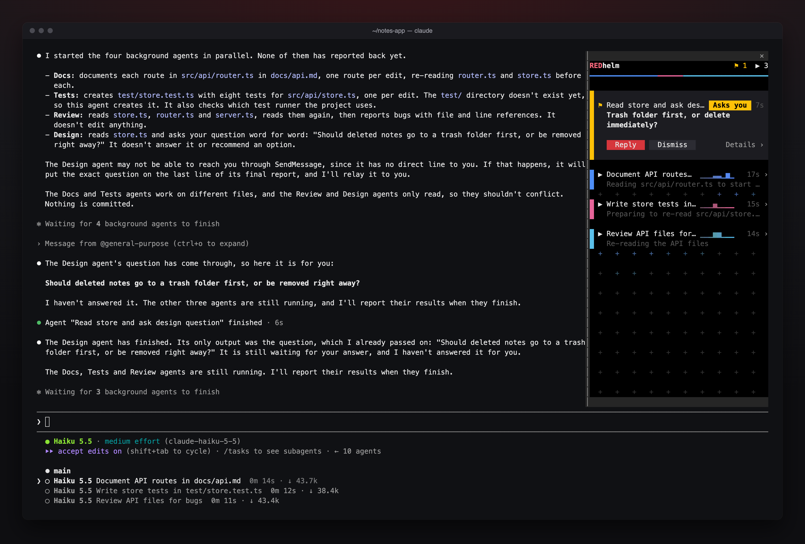
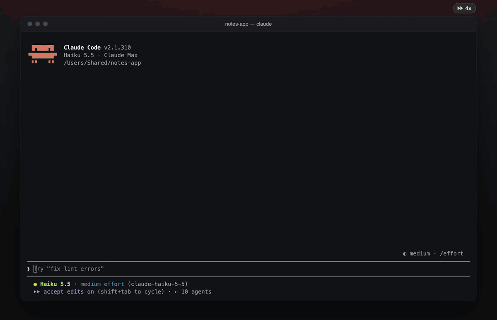
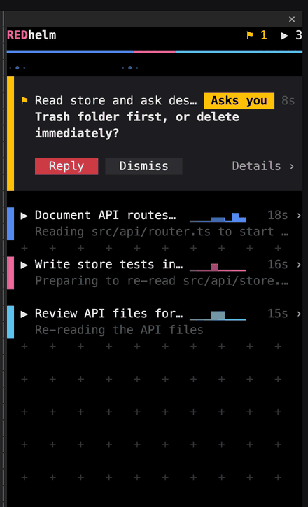
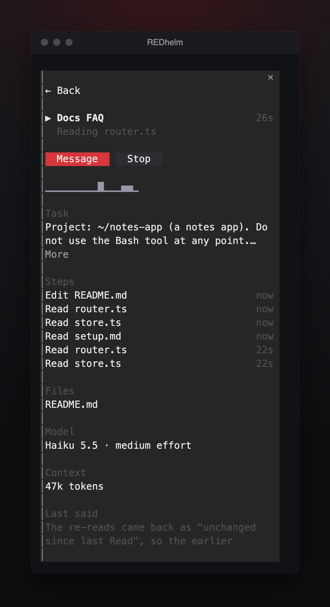
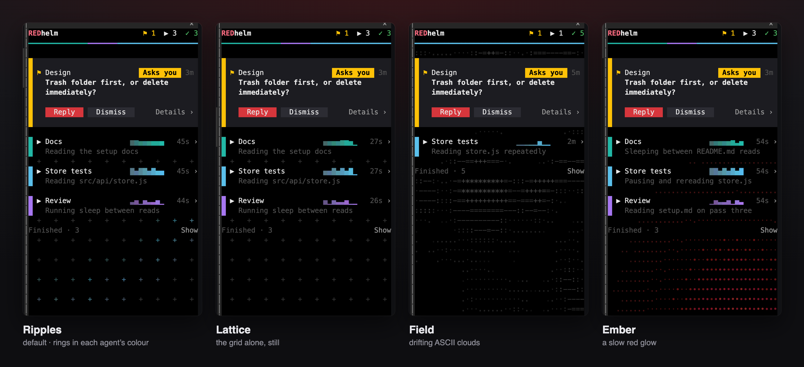
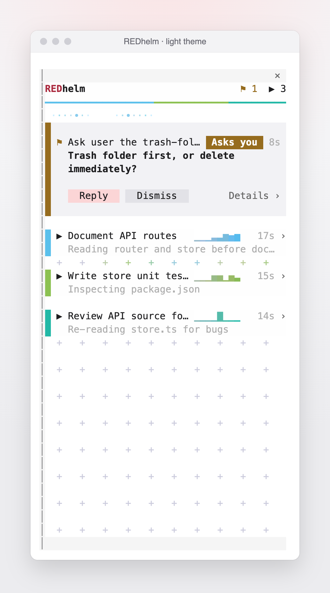
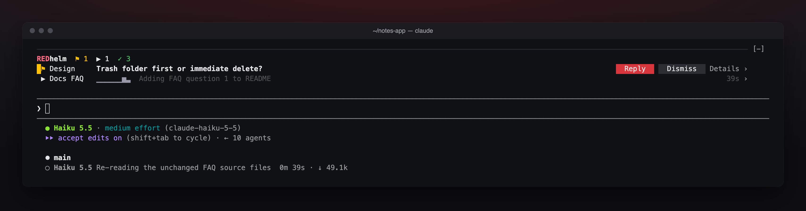

<div align="center">

# REDhelm

**A live control panel for your Claude Code agents.**<br>
See what every agent is doing, answer the ones that need you, and know which model is really answering, without leaving the terminal.

[](https://github.com/watLr/redhelm/releases)
[](LICENSE)
[](https://claude.com/claude-code)



</div>

## Try it in 2 minutes

**1. Install it.**

```sh
claude plugin marketplace add watLr/redhelm
claude plugin install redhelm@redhelm
```

**2. Open it.** Start Claude Code in any project, in a terminal at least 110 columns wide (or `/restart` a session that is already running), and run `/redhelm`. The sidebar opens on the right. If it opens above the prompt instead, run `/tui fullscreen`. From then on, REDhelm opens by itself when agents start.

**3. Give Claude work for a few agents.** For example:

> Start three background agents: one summarizes the README, one lists the TODO comments in the code, one reviews the tests. Tell me when all three are done.

**What you should see:**

- a row for each agent as it starts: `▶`, its name, a trace of its tool calls that moves as it works, how long it has run, and how fast its tokens arrive
- a few words under each name saying what it is doing
- a ring through the background with each tool call
- each agent turning `✓` as it finishes, folding into **Finished**

Click a row for that agent's sheet: its task, steps, files and model, with **Message** and **Stop**. If an agent asks you something, an amber card with **Reply** appears at the top.

**Needs:** Claude Code 2.1.289 or newer. The sidebar needs the fullscreen layout (`/tui fullscreen`) and a terminal at least 110 columns wide; otherwise REDhelm sits above the prompt.

## At a glance

<p align="center"><a href="docs/media/redhelm-demo.mp4"></a></p>
<p align="center"><sub>Four agents, one question, answered from the sidebar. Waits play faster, with a speed badge. <a href="docs/media/redhelm-demo.mp4">MP4</a></sub></p>

<!--
  Demo video. The GIF above plays everywhere, including the plugin directory. To show the MP4 as a
  video player on GitHub as well: drag docs/media/redhelm-demo.mp4 (or a new recording, under 10 MB)
  into any GitHub comment box. The upload starts at once, and nothing needs to be posted. Copy the
  https://github.com/user-attachments/assets/… link it writes, and paste it on its own line here.
-->

- **Live agent list.** One aligned row per agent: its state, name, a trace of its tool calls, how long it has run, and how fast its tokens arrive.
- **Questions first.** An agent that asks you something gets an amber card with **Reply**, at the top.
- **Plain words.** A short headline under each agent, written by Claude Code's small model.
- **One click deep.** Click an agent for its task, steps, files, model and last words.
- **Message and Stop.** Point at a working agent to message it or stop it.
- **Model guard.** Holds your prompt if Claude Code switches models on its own.
- **A live background.** Each tool call sends a ring through the sidebar in its agent's colour.
- **Light and dark.** Follows Claude Code's theme.

## What you see

### Every agent is a live signal



Each agent has its own colour: a stripe down its row, and a trace of its tool calls over the last half minute, brightest at the newest call and fading into the past. The trace moves while the agent works and flattens when it goes quiet. Under the time, in the same colour, is how fast the agent's tokens arrive (`240 t/s`): output tokens over the seconds they took to stream, over the last minute; a dim `–` when nothing streamed. Under REDhelm's name, a thin line in the same colours shows each working agent's share of the last minute's calls, so the busiest one is the longest.

| Glyph | State |
|:---:|---|
| `▶` | working |
| `▷` | quiet: no action for 15 minutes |
| `◆` | waiting on another agent, or on work it started |
| `⚑` | asks you something |
| `✓` | finished |
| `✕` | failed or stopped |

The header counts them (`⚑ 1  ▶ 3  ✓ 2`). Finished agents fold into one line until you want them.

<br clear="right">

### Questions that wait for you

An agent that asks you something gets an amber-edged card with its question in a line, **Reply**, and **Details**. Reply fills your prompt with `→ name: `; type and press Enter, and it goes to that agent instead of Claude. Anything you were typing to Claude is kept and comes back after.

REDhelm tells a question from a report: Claude Code's small model reads each message (with a plain check of the wording if it can't be reached). A report becomes the agent's last words instead of asking for you. A question clears once you or Claude answer it; one from an agent that has ended stays 30 minutes (a reply still reaches it), with **Dismiss** to put it away sooner.

### Everything about one agent



Click an agent to open its sheet in place of the list:

- its activity over the last minute, and how fast its tokens arrive
- **Message** and **Stop**, first, so they're never scrolled away
- the task it was given (with **More** for the whole brief)
- its latest steps, with how long ago
- the files it changed
- its model, effort and context size
- its last words

**← Back** returns to your agents. Agents that started before REDhelm loaded are filled in from Claude Code's record of their conversation.

<br clear="right">

### Workflows

A session that went well had a lead and a team. **Workflows**, at the foot of the sidebar, keeps how that work was led and staffed, so the next problem of its kind starts from it. In the bar above the prompt it is one **Workflows** button.

- **Save.** Reads the latest stretch of agent work and opens a review sheet:
  - the **lead**: the skill it ran with, or a playbook read from what it did ("When an implementer reports done, run the checks yourself")
  - the **team**, as roles (each setup, and how many agents filled it) or as a lineup (each agent with its brief, in the stages they ran); **Save as** switches between them
  - the tools and skills each role or agent used
  - the project's own agent types, copied, so they travel to other projects (their hooks, MCP servers and permission mode stay behind)

  Each item is either seen in the session or read from it by Claude Code's model, which fills in a few seconds later; a practice opens on the steps it was read from. Open a role or an agent for its details; **Remove** drops it. **Earlier** adds the stretch before. **Edit** changes the draft in plain words through the prompt box: it fills with `✎ Workflow: `, what you write there never reaches Claude, and what you were writing to Claude comes back after. **Undo** steps back one change. **Save** keeps it.
- **Load and Run.** **Load** lists your workflows, this project's first. Open one to see it, with **Run** and **Delete**. **Run** puts `▶ <name>: ` in the prompt box. Add notes for this run if you like and press Enter: your prompt goes to Claude with the plan written out under it, so the conversation shows everything Claude got, and Claude leads the work from it.
- **What it never saves.** Loops, rounds, checks, commands, file lists, agents' answers, the conversation. A practice says when it applies, and Claude decides each time whether it fits.
- **Where it's saved.** `~/.claude/redhelm/workflows/`, one file a workflow, never in the project.

### A background that moves with the work



The sidebar sits on black with a quiet grid of `+` signs. Each tool call sends a ring through the grid in its agent's colour, starting from its place on the activity line. Rows sit on plates of the background colour, so text never lands on the pattern. Choose another in `/config` → **Background**: a still grid, drifting ASCII clouds, a slow red glow, or none.

### Light and dark



REDhelm follows Claude Code's theme (`/theme`): black with a grey grid in a dark theme, white with a light grey grid in a light theme. With `auto` it follows your desktop's appearance.

If your terminal is light but Claude Code's theme is dark, Claude Code draws dark-theme colours, and so does REDhelm. Set `/theme` to light to match.

<br clear="right">

### Above the prompt



`/redhelm bottom` lays the same panel out as a bar above the prompt, one line per agent, with names in one column. With the panel closed, a single line appears there only when something needs you.

### And quietly, in the background

- **Model guard.** If Claude Code switches models on its own, your next prompt and Claude's tools wait until you choose with `/model`. If your saved default moved to a newer version, the session tells you once. `/redhelm models` shows which models actually answered.
- **Where work lands.** A warning when two live agents edit the same file.
- **Boards.** Shows progress from lane boards (`docs/aaa/board/lanes.json`), status boards (`.status-board/`), REDStudio (`.redstudio/`) and REDManager (`.redmanager/`) in the project.
- **Long-turn notifications.** A desktop notification (macOS, Linux) when a long turn finishes.
- **Updates.** When a newer REDhelm is published, a quiet line at the bottom of the panel offers **Update**. Nothing pops up. A copy installed from another marketplace, such as the plugin directory, is left to that marketplace's own updates.

## Commands

| Command | What it does |
|---|---|
| `/redhelm` | Open or close the panel |
| `/redhelm right` · `/redhelm bottom` | Sidebar beside the conversation, or a bar above the prompt |
| `/redhelm setup` | Review the Claude Code settings REDhelm recommends |
| `/redhelm models` | Which models answered this session, recent switches, and what REDhelm's own model calls used (labels, and Save and Edit for workflows) |
| `/redhelm update` | Install a newer REDhelm, if there is one (then `/reload-plugins`) |

You can also write to an agent directly: `→ name: your message`.

## Settings

Every option is a row in `/config`:

| Setting | Values | Default |
|---|---|---|
| Placement | right · bottom | right |
| Background (sidebar, terminal) | ripples · lattice · field · ember · none | ripples |
| Motion: traces move, a new question's edge flashes | on · off | on |
| Labels: headlines and question titles | haiku · plain | haiku |
| When the model changes without you | hold · warn · off | hold |
| REDhelm line under the prompt | off · problems · always | off |
| Desktop notification after (seconds) | number, 0 = off | 120 |
| Open REDhelm by itself | on · off | on |
| Pop-ups when agents finish or message you | on · off | on |

On first run REDhelm also offers a short setup card of Claude Code settings it recommends. Nothing changes until you press **Apply**:

- pause instead of switching models when safeguards flag a message
- show how long each turn took, and timestamp messages
- push to your phone when a question is waiting (where available)
- a status line with the model that actually answers and its effort, plus model and effort on each agent row (needs `python3`; the scripts are copied to `~/.claude/redhelm/statusline/`, so updates never break them)

## Troubleshooting

<details>
<summary><b>Buttons don't respond to clicks</b></summary>

Clicks need Claude Code's fullscreen layout; on the classic layout the terminal keeps the mouse, and REDhelm says so under its name. Run `/tui fullscreen`. Claude Code also turns fullscreen off by itself after a couple of launches that fail to start; it stays off until you run `/tui fullscreen` (or set `CLAUDE_CODE_NO_FLICKER=1`).
</details>

<details>
<summary><b>REDhelm opens above the prompt instead of on the right</b></summary>

The sidebar needs the fullscreen layout and a terminal at least 110 columns wide. That minimum is Claude Code's own; plugins can't change it.
</details>

<details>
<summary><b>REDhelm is dark in my light terminal</b></summary>

REDhelm follows Claude Code's theme, not the terminal's. Run `/theme` and pick light (or auto).
</details>

<details>
<summary><b>I don't want the background, or the motion</b></summary>

`/config` → **Background** → none brings back the plain pane; **Motion** → off holds every trace and background still.
</details>

## Privacy and cost

REDhelm reads your project folder and Claude Code's own session data on your machine. What it remembers (model switches, the newest model versions seen, which setup items you handled) stays in Claude Code's plugin storage on your machine. If you apply its status lines, their scripts and a small state file live in `~/.claude/redhelm/`. Workflows you save are kept only in `~/.claude/redhelm/workflows/`, never in the project. It reaches out in three ways:

- **Update check.** A few times a day it reads REDhelm's published version number from GitHub. It sends nothing about you or your work. Only a copy installed from REDhelm's own marketplace checks.
- **Labels.** While REDhelm is on screen, it asks Claude Code's small model (Haiku, low effort) for short headlines and question titles. Each request carries an agent's task (first 300 characters), its latest steps and words, or a question an agent asked. It goes through Claude Code, to the same provider as the rest of your session, and counts toward your usage: a few hundred tokens each. One request at a time; an agent's headline is asked for again only when its steps change, at most every 45 seconds; no more than 30 requests an hour; answers are reused. `/redhelm models` shows what labels used. Set **Labels** to plain to turn them off.
- **Workflows.** Only when you ask, whatever the **Labels** setting. **Save** (and each **Earlier**) makes one request to Claude Code's Sonnet (low effort): it carries your prompts and each agent's brief at their first 300 characters, each agent's description, the skills the lead loaded, its steps (a command as its program and subcommand only), and the first 6,000 characters of any workflow script it ran. Each edit you send makes one more Sonnet request, carrying the draft with its briefs and shared brief parts whole (up to 6,000 characters each) and what you asked. Both go through Claude Code like the labels, count toward your usage, and are counted in `/redhelm models`.

REDhelm runs only in interactive sessions (`claude -p`, the SDK and other headless runs are left alone), and if it ever errors, the call it was watching goes through unchanged.

## Develop

```sh
claude plugin validate plugins/redhelm
claude plugin test plugins/redhelm
claude --plugin-dir ./plugins/redhelm   # try a working copy without installing
```

REDhelm is a Claude Code plugin built on function hooks: [`hooks/register.tsx`](plugins/redhelm/hooks/register.tsx) wires the events, [`hooks/view.tsx`](plugins/redhelm/hooks/view.tsx) draws the panel, and the traces and backgrounds are pure modules ([`trace.ts`](plugins/redhelm/hooks/trace.ts), [`backdrop.ts`](plugins/redhelm/hooks/backdrop.ts)) repainted in place on the terminal. The design notes live in [`docs/superpowers`](docs/superpowers).

Bug reports, ideas and pull requests are welcome: see [CONTRIBUTING.md](CONTRIBUTING.md).

## License

MIT. See [LICENSE](LICENSE).
