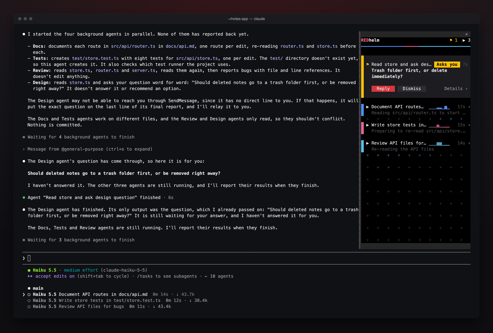

# REDhelm

A live control panel for your Claude Code agents. REDhelm docks a sidebar beside the conversation with one row per agent: what it is doing, a trace of its tool calls, and how long it has run. An agent that asks you something waits at the top with **Reply**, so you can answer it without leaving the terminal. A model guard holds your prompt if Claude Code switches models without you.



## Install

```sh
claude plugin marketplace add watLr/redhelm
claude plugin install redhelm@redhelm
```

Restart running sessions (`/restart`), then run `/redhelm` once to open it. After that it opens by itself when agents start.

## Requirements

- Claude Code CLI 2.1.289 or newer
- For the sidebar: Claude Code's fullscreen layout (`/tui fullscreen`) and a terminal at least 110 columns wide. Otherwise REDhelm sits above the prompt.
- Optional: `python3`, for the status line REDhelm's setup card offers

## Features

- **Live agent list:** each agent's state, name, activity trace, run time and token rate, in its own colour
- **Questions first:** an agent that asks you something gets an amber card with **Reply**
- **Agent sheet:** click an agent for its task, steps, files, model and last words, with **Message** and **Stop**
- **Headlines:** a few words under each agent, from Claude Code's small model, or plain words if you prefer
- **Model guard:** holds your prompt if Claude Code switches models on its own
- **Workflows:** save how a session's agents were led and staffed, and run it again later from **Load**
- **Two layouts:** a sidebar on the right, or a bar above the prompt (`/redhelm bottom`)
- **Light and dark:** follows Claude Code's theme

## Privacy and cost

REDhelm reads your project folder and Claude Code's session data on your machine, and keeps what it remembers there too. Headlines, and the reading of each message an agent sends you to tell a question from a report, are short requests to Claude Code's small model that count toward your usage; set **Labels** to plain in `/config` to turn them off, and REDhelm's wording check decides instead. A workflow's **Save** and **Edit** ask Claude Code's Sonnet, only when you press them; set **Workflow reading** to off to turn that off. No analytics, no telemetry, no server of REDhelm's own. The details are in the [privacy policy](https://github.com/watLr/redhelm/blob/main/PRIVACY.md).

## What REDhelm runs, sends and changes

**Programs it runs**, each written out in full in its code:

- `python3 --version`: whether its status lines can run
- `defaults read -g AppleInterfaceStyle` on macOS, or `gsettings get org.gnome.desktop.interface color-scheme` on Linux: whether your desktop is light or dark, for Claude Code's `auto` theme

Each of these only reads. REDhelm uses the answer on your machine and sends it nowhere.

**Notifications:** after a turn longer than you set in `/config` (0 turns it off), REDhelm asks Claude Code to notify you, with Claude Code's own `$.ui.notify` call. It goes through Claude Code's own notification setting. Where that setting shows text, it shows your project's name, how long the turn took and the first line of Claude's answer, cut to 140 characters.

**What it sends, and where:**

- No web requests of its own.
- Model calls, through Claude Code with your own sign-in, to the same provider as your session: parts of your conversation and your agents' work, for headlines, question titles, telling a question from a report, and a workflow's **Save**, **Earlier** and **Edit**. The privacy policy lists what each one carries, and `/config` turns them off.
- Nothing else. REDhelm reads your Claude Code settings only for your model, your theme, its status lines and the settings its setup card offers, and `HOME` (`USERPROFILE` on Windows) for your home folder. It uses nothing else from them, and sends none of it anywhere.

**Files it writes**, in your home folder, never in your project:

- `~/.claude/redhelm/statusline/`: copies of its status line scripts, which Claude Code runs as your status lines once you apply them. They read files on your machine, write the newest model versions they have seen to `~/.claude/redhelm/state/`, and send nothing.
- `~/.claude/settings.json`: only its `statusLine` and `subagentStatusLine` entries, when you press **Apply** on its setup card. After that it keeps them pointing at the copies above. The rest of the file stays as it was.
- `~/.claude/redhelm/workflows/`: the workflows you save. **Delete** empties a workflow's file.

**Settings it changes:** only when you press **Apply** on its setup card, `switchModelsOnFlag`, `turnDuration`, `timestamps` and `inputNeededNotifEnabled`, as `/config` would. `/redhelm right` and `/redhelm bottom` change REDhelm's own placement. It never changes your permission mode and sets no environment variables.

**What it does for you:**

- **Stop** on an agent calls Claude Code's `TaskStop` tool for that agent. REDhelm calls no other tool.
- **Run** on a saved workflow adds the workflow's copied agent types for that session, named `redhelm:<name>`, without their hooks, MCP servers or permission mode.
- It adds one command, `/redhelm`.

**What its hooks do with what they see:**

- Your prompts: the model guard holds a prompt while Claude Code has switched models on its own, and holds one prompt, once, when the session runs an older model than your default (send it again to go on). A prompt that starts `→ name:` goes to that agent as a message from you, not to Claude. `▶` runs a saved workflow, its plan written out under your words. `✎` changes a workflow draft and never reaches Claude. Every other prompt passes unchanged.
- Tool calls: while the guard holds, the main conversation's tool calls are refused, with the reason. An agent's calls are recorded for its row and passed on unchanged.
- Agents starting, responses, turns ending, messages to and from agents, and model switches are read for the panel and passed on unchanged.
- REDhelm never approves a tool call or answers a permission prompt for you.

## More

Screenshots, a demo, every setting and troubleshooting: [github.com/watLr/redhelm](https://github.com/watLr/redhelm). A REDStandard product, MIT licensed.

Found a bug or have an idea? Press **Feedback** at the foot of the sidebar, run `/redhelm feedback`, or [open an issue](https://github.com/watLr/redhelm/issues/new/choose). For a security problem, [report it privately](https://github.com/watLr/redhelm/security/advisories/new).
